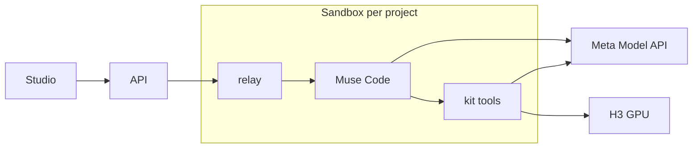

# MuseClone Studio

Great videos follow a formula. MuseClone measures it, turns it into a template, and an agent makes it again for
your product. Today: 30 s and 15 s spots from top-performing ads. Next: any format, any length.

Meta Global AI Developer Hackathon · Startups track · Build for Your World

## Meta models

| Model | Role |
|---|---|
| Muse Code | The production agent. One sandboxed session per project. |
| Muse Spark · Muse Wonder | Its models (Demo · Live). |
| Muse Image | Plates, cast and product sheets, storyboards. |
| Muse Voice Transcribe | Measures the spoken lines of an ad. |

<sub>Video: MiniMax-H3 (open weights) on our GPU. Other agent providers can be plugged in later.</sub>

## How it works

1. **Measure.** Every cut, fade, loudness curve and line of an ad, in seconds. No model, ~17 s.
2. **Template.** Each shot's framing, camera, light, text and sound as numbers, plus swappable assets and a
   storyboard per shot. Cut to 30 s and 15 s on the music's bars.
3. **Benchmark.** The spot is regenerated from the template alone and compared with the original.
4. **Produce.** Swap in your product, cast and lines. Every file lands on a live canvas.



## Run

```bash
npm install
cp .env.example .env      # META_API_KEY
npm run sandbox:image
npm run dev               # http://localhost:5180
```

## Notes

- Built during the hackathon (Oct 26 – Nov 4, 2026). The H3 GPU setup it calls predates the event.
- Third-party ads and their audio stay out of this repo. Cast are invented, brands are slots, music is
  original.

## Map

`src/client` UI · `src/worker` API and sandbox runtime · `sandbox/kit` agent tools · `sandbox/templates` 16
templates · `sandbox/seeds` recorded sessions · `docs/pitch` publishing scripts
