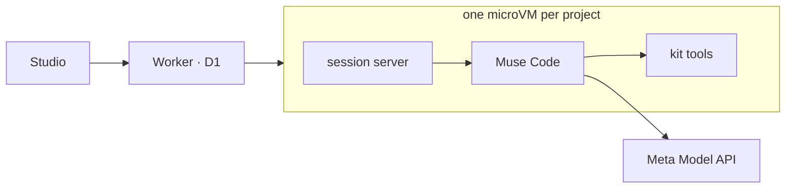

# Shotprint

**The video template marketplace for AI agents.**

A stock video template is a project file a person has to edit. A Shotprint template is written for an agent
to run: every shot's timing, framing, camera, light, text and sound, with a storyboard per shot and
swappable cast, product and places. Pick one, add one sentence, and Muse Code makes the 30 s and 15 s spots.

**Live demo:** https://shotprint.hosung-jang.workers.dev (judges: the passcode for Live mode is in the
submission notes)

Meta Global AI Developer Hackathon · Startups track

## How it works

1. **Marketplace**: browse templates by goal, industry, tone and cast. Each is benchmarked: the original
   is remade from the template alone and shown side by side.
2. **Make a video**: Muse Code directs the film in the project's own microVM; every file lands on a live
   canvas you can steer.
3. **Build a template**: upload a video that works. The agent measures it, writes the template and
   benchmarks it. Keep it private or list it.

Every template ships with its fill recipe (`sandbox/kit/.claude/skills/template-fill`), so any agent can
run it with the video model it already uses.



## Meta models

| Model | Role |
|---|---|
| Muse Code | The agent that makes the film or the template |
| Muse Spark · Muse Wonder | Its reasoning (Demo · Live) |
| Muse Image | Plates, cast and product sheets, storyboards |
| Muse Voice Transcribe | Measures the spoken lines of a reference |

Video clips: MiniMax-H3 (open weights) on our own GPU, off in the live demo.

## Run

```bash
npm install
cp .env.example .env      # META_API_KEY
npm run sandbox:image     # Docker, or sandbox:image:vm for Apple's container
npm run dev               # http://localhost:5180
```

Deploy to Cloudflare (Workers, D1, R2, Containers):

```bash
npx wrangler secret put META_API_KEY && npx wrangler secret put JUDGE_PASSCODE
npm run db:migrate:remote
npm run cf:deploy
```

## Repo map

| Path | What |
|---|---|
| `src/client` | Studio UI (React) |
| `src/worker` | API, Cloudflare entry, sandbox runtime |
| `sandbox/kit` | What the agent gets: instructions, tools, skills |
| `sandbox/templates` | The templates |
| `sandbox/seeds` | Recorded sample sessions |

Built during the hackathon (Oct 26 – Nov 4, 2026). Cast are invented and brands are slots; the source ads
stay out of this repo.
