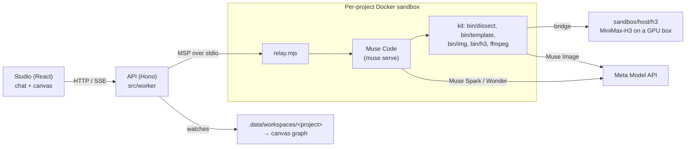

# MuseClone Studio

**Turn the structure of a top-performing ad into a template, then produce a 30 s and a 15 s spot for your
own product from it, with an AI agent doing the production work in a private sandbox.**

Built for the Meta hackathon on Meta's stack: **Muse Code** is the agent, **Muse Spark / Muse Wonder** are its
models, **Muse Image** draws stills, and MiniMax-H3 (open weights, our own GPU) renders video.

---

## For reviewers: what to look at (5 minutes)

1. **Watch the demo video** (link in the submission form). It shows everything below, including the parts
   that need a GPU and the benchmark footage we can't put in a public repo (see *What is local only*).
2. **Template library** (`Templates` in the sidebar): 16 production formats built from Meta films and
   top-performing 2025–26 ads. Each delivers a 30 s and a 15 s cut.
3. **Benchmark** (`Compare` on a card): the original ad cut to 30 s (left) next to the spot our pipeline
   regenerated **from the template alone** (right), without access to the original footage. Same shots, same
   timing, same sound design; invented cast and brand.
4. **Example productions** (inside a template): ten Meta products made from these templates (Ray-Ban Display,
   Quest 3S, Quest 3, Ray-Ban Meta, Marketplace, WhatsApp, Meta AI, the Meta AI app, Threads), each at 30 s and
   15 s.
5. **A recorded project** (`Meta VR Glasses × Founder on the factory floor` in the sidebar): a real agent
   session replayed. The chat on the left is Muse Code's turn stream (plans, tool calls, renders, the
   interruptions and resumes); the canvas on the right is every file it produced, wired by how each was made.

## Why it works

- **Ads that work have structure.** Hook, cut timing, framing, the moment the music drops, the line that lands
  on the product. Agencies copy structure by hand; we measure it.
- **Video models make shots, not films.** A shot holds for 2–10 s; a model stays consistent across 10–15
  shots. That is a 30 s or 15 s spot, so the product is built for spots, not long films.
- **A template is measured, not described.** Every cut, fade, brightness level, loudness curve and spoken line
  is measured in seconds with no model (`bin/dissect`, ~17 s for a 90 s ad). The agent then writes each shot's
  framing, camera move, light, text and sound as numbers, draws the swappable assets (cast, product, places,
  screens) and a storyboard per shot, and cuts the 30 s and 15 s versions on the music's bars.
- **Every template is benchmarked.** A second agent that never sees the ad regenerates it from the template
  alone, and we review it side by side with the original. A template that can't be regenerated isn't shipped.

| Step | Time (one shared GPU) |
|---|---|
| Measure an ad | ~17 s, no model |
| Author the 30 s + 15 s template | 15–47 min |
| Benchmark: regenerate the 30 s cut | 12–62 min (11–16 clips) |
| Benchmark: regenerate the 15 s cut | 10–30 min (6–10 clips) |
| A new 30 s spot for your product | 24–55 min (12–14 clips) |
| Its 15 s version | 2–6 min (reuses the 30 s clips) |

## How it is built



- **One sandbox per project.** `src/worker/sandbox/docker.ts` starts a container from `sandbox/image`, mounts
  the project's workspace and runs `muse serve` behind `sandbox/host/relay.mjs`. The chat's send, steer, queue
  and stop are Muse Code's own protocol commands (`src/worker/sandbox/msp.ts`).
- **The canvas is the workspace.** `src/worker/sandbox/graph.ts` turns the agent's files and its own records
  (plans, cut lists, render jobs) into a graph: what was rendered from which still, which voice drives which
  take, what landed in the final cut.
- **The kit** (`sandbox/kit`) is what the agent works with: `AGENTS.md` (how to work), `TOOLS.md`, measuring
  and template tools, and the `template-fill` skill.
- **Templates** live in `sandbox/templates/<id>` (`TEMPLATE.md`, `template.json`, storyboards, asset sheets);
  the catalog the Studio shows is `src/shared/studio-templates.ts`.
- **Spend is capped in code** (`STUDIO_USD_CAP`). Demo mode runs Muse Spark only; Live mode (judge passcode)
  unlocks Muse Wonder.

## Run it locally

Requirements: Node 22, Docker, a Meta Model API key.

```bash
npm install
cp .env.example .env          # add META_API_KEY
npm run sandbox:image         # builds the per-project sandbox image (muse-harness)
npm run dev                   # Studio on http://localhost:5180
```

- Without Docker the Studio still opens; sessions are read-only.
- Rendering new video needs a GPU box running our MiniMax-H3 stack (`H3_ENABLED=1`, `H3_HOST`); without it
  the agent still plans, writes, draws stills (Muse Image) and edits existing footage.
- `npm run cf:deploy` deploys the UI and API to Cloudflare. The Cloudflare version of the per-project sandbox
  is not wired yet, so agent sessions run on the local server only.

## What is local only, and why

The repo holds code, templates and our own generated assets. These stay off GitHub on purpose:

- **Benchmark footage** (`public/templates/proof/`): the left half is the original third-party ad.
- **Source films and source audio** (`sandbox/references/`, template scores and lines): other companies'
  footage and music.
- **Example productions and recorded workspaces** (`public/templates/examples/`, `.data/`): size.

The demo video shows them; we can share them privately with the judges on request.

## Responsible use

- **No likenesses.** All cast are invented people. Each template is checked against the source's real people,
  including stacked signature traits (hair, glasses, team colours); one template was recast because of this.
- **No third-party brands.** Products and taglines are slots with invented defaults ("Voyalo", "rosabel",
  "Lumen Aria"); Meta's own products are the only real brands used.
- **Original music.** The example productions use music synthesized for them on each template's beat grid
  (`docs/pitch/own_score.py`), not the source ads' soundtracks.
- **Audio is never retimed.** Voice takes are placed once on the timeline; picture is trimmed around them.

## Repository map

| Path | What |
|---|---|
| `src/client` | Studio UI (React, Vite): landing, home, template library, project chat + canvas |
| `src/worker` | API (Hono): projects, templates, sandbox runtime, workspace graph |
| `src/shared` | Types and the template catalog shared by UI and API |
| `sandbox/image` | Dockerfile of the per-project sandbox |
| `sandbox/host` | Host side: MSP relay, H3 render bridge, template seeding |
| `sandbox/kit` | What the agent gets in every workspace: instructions, tools, skills |
| `sandbox/templates` | The 16 templates |
| `sandbox/seeds` | Recorded agent sessions shown as sample projects |
| `docs/pitch` | Pitch notes and the scripts that publish templates and build pitch media |
| `docs/studio` | Product spec and the running log of decisions and open items |
